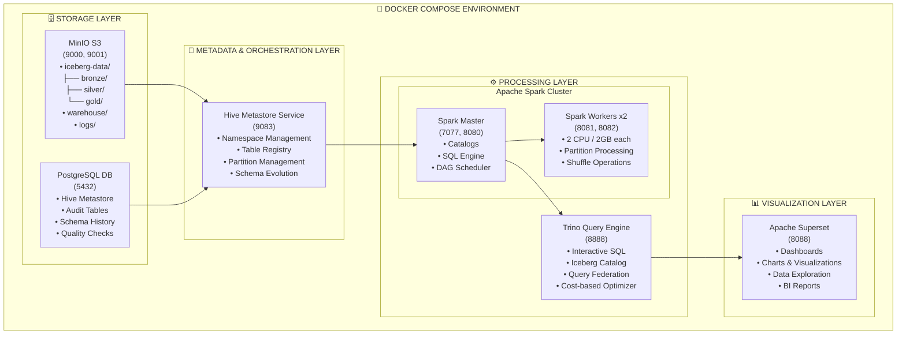
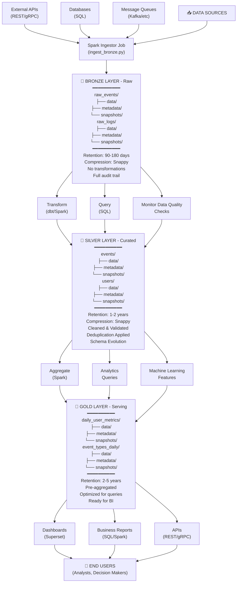

# 🏗️ Arquitectura OpenData - Diagrama Completo

Visualización de la arquitectura del proyecto OpenData con Docker Compose, MinIO, Iceberg y arquitectura medallion.

---

## 📐 Diagrama General del Sistema



---

## 🔄 Flujo de Datos - Arquitectura Medallion



---

## 🗂️ Estructura de Buckets MinIO

```
minio/
│
├── iceberg-data/  ◄─────────── Principal bucket para Iceberg
│   │
│   ├── bronze/    ◄─────────── Raw data layer
│   │   ├── raw_events/
│   │   │   ├── data/
│   │   │   │   ├── year=2026/
│   │   │   │   │   ├── month=5/
│   │   │   │   │   │   ├── day=1/
│   │   │   │   │   │   │   ├── 00000-0-*.parquet
│   │   │   │   │   │   │   └── ...
│   │   │   │   │   │   └── day=2/
│   │   │   │   │   └── month=6/
│   │   │   │   └── year=2027/
│   │   │   ├── metadata/
│   │   │   │   ├── 00000-*.avro
│   │   │   │   ├── 00001-*.avro
│   │   │   │   └── version-hint.txt
│   │   │   └── snapshots/
│   │   │       ├── snap-*.avro
│   │   │       └── ...
│   │   │
│   │   └── raw_logs/
│   │       ├── data/
│   │       ├── metadata/
│   │       └── snapshots/
│   │
│   ├── silver/    ◄─────────── Curated data layer
│   │   ├── events/
│   │   │   ├── data/
│   │   │   ├── metadata/
│   │   │   └── snapshots/
│   │   │
│   │   └── users/
│   │       ├── data/
│   │       ├── metadata/
│   │       └── snapshots/
│   │
│   └── gold/      ◄─────────── Serving/Analytics layer
│       ├── daily_user_metrics/
│       │   ├── data/
│       │   ├── metadata/
│       │   └── snapshots/
│       │
│       └── event_types_daily/
│           ├── data/
│           ├── metadata/
│           └── snapshots/
│
├── warehouse/     ◄─────────── Iceberg warehouse metadata
│   ├── 00000-*.avro
│   └── version-hint.txt
│
└── logs/          ◄─────────── Operation logs
    ├── etl/
    │   ├── 2026-05-10.log
    │   └── ...
    ├── queries/
    │   ├── 2026-05-10.log
    │   └── ...
    └── errors/
        ├── 2026-05-10.log
        └── ...
```

---

## 🔌 Puertos y Conexiones

```
┌────────────────────────────────────────────────────────────────┐
│              SERVICE PORTS & CONNECTIONS                       │
└────────────────────────────────────────────────────────────────┘

┌─────────────────────────────────────────────────────────────┐
│ SERVICE           │ PORT(s) │ ACCESS              │ PURPOSE │
├─────────────────────────────────────────────────────────────┤
│ PostgreSQL        │ 5432   │ Internal only       │ DB      │
│ MinIO API         │ 9000   │ http://localhost    │ S3 API  │
│ MinIO UI          │ 9001   │ http://localhost    │ Web UI  │
│ Hive Metastore    │ 9083   │ Internal (Thrift)   │ Catalog │
│ Spark Master      │ 7077   │ Internal (Spark RPC)│ Cluster │
│ Spark Master UI   │ 8080   │ http://localhost    │ Web UI  │
│ Spark Worker 1    │ 8081   │ http://localhost    │ Web UI  │
│ Spark Worker 2    │ 8082   │ http://localhost    │ Web UI  │
│ Spark Driver      │ 4040   │ http://localhost    │ Job UI  │
│ Trino             │ 8888   │ http://localhost    │ Web UI  │
│ Superset          │ 8088   │ http://localhost    │ Web UI  │
└─────────────────────────────────────────────────────────────┘

Network Connectivity:
┌─────────────────────────────────────────┐
│        opendata-network (bridge)        │
├─────────────────────────────────────────┤
│                                         │
│  All containers can communicate via:   │
│  • hostname (service name)              │
│  • Internal DNS resolution              │
│  • No external network required         │
│  • Persistent volumes for data          │
│                                         │
└─────────────────────────────────────────┘
```

---

## 📋 Tabla de Componentes

```
┌────────────────────────────────────────────────────────────────────────┐
│ COMPONENT        │ IMAGE                    │ PURPOSE                  │
├────────────────────────────────────────────────────────────────────────┤
│ PostgreSQL       │ postgres:15-alpine       │ Hive Metastore DB       │
│ MinIO            │ minio/minio:latest       │ S3-compatible storage   │
│ Hive Metastore   │ bde2020/hive:2.3.9-*     │ Metadata catalog        │
│ Spark Master     │ bde2020/spark-master:*   │ Cluster orchestration   │
│ Spark Workers    │ bde2020/spark-worker:*   │ Data processing         │
│ Trino            │ trinodb/trino:latest     │ SQL query engine        │
│ Superset         │ apache/superset:latest   │ BI & visualization      │
│ MinIO Init       │ minio/mc:latest          │ Bucket provisioning     │
└────────────────────────────────────────────────────────────────────────┘
```

---

## 🔐 Data Flow Security

```
┌─────────────────────────────────────────┐
│      Data & Access Control              │
├─────────────────────────────────────────┤
│                                         │
│  Storage:                               │
│  ├── MinIO: S3 credentials              │
│  ├── PostgreSQL: User/password          │
│  └── Iceberg: Schema enforcement        │
│                                         │
│  Audit:                                 │
│  ├── audit_operations table             │
│  ├── schema_evolution table             │
│  ├── data_snapshots table               │
│  └── etl_executions table               │
│                                         │
│  Compliance:                            │
│  ├── Full change tracking               │
│  ├── Snapshot history                   │
│  ├── Access logs                        │
│  └── Data lineage                       │
│                                         │
└─────────────────────────────────────────┘
```

---

**Documento**: Arquitectura OpenData  
**Versión**: 1.0  
**Actualización**: Mayo 2026
