# 📑 Índice Completo del Proyecto OpenData

## ✅ Implementación Finalizada

Se han creado **16 archivos nuevos** organizados en una estructura profesional y documentada.

---

## 📂 Estructura del Proyecto

```mermaid
flowchart TD
   root["opendata/"]
   readme["README.md"]
   quick["QUICKSTART.md"]
   arch["ARCHITECTURE_DIAGRAM.md"]
   impl["IMPLEMENTATION_SUMMARY.md"]
   index["FILE_INDEX.md"]
   docdir["doc/"]
   doc1["01_SPECS.md"]
   doc2["02_PLAN.md"]
   docker["docker/"]
   compose["docker-compose.yml"]
   envfile[".env"]
   config["config/"]
   sparkconf["spark/spark-defaults.conf"]
   trino["trino/catalog/iceberg.properties"]
   postgres["postgres/init.sql"]
   scripts["scripts/"]
   initb["init-buckets.sh"]
   createTables["create_iceberg_tables.py"]
   ingest["ingest_bronze_data.py"]
   transform["transform_silver_data.py"]
   aggregate["aggregate_gold_data.py"]

   root --> readme
   root --> quick
   root --> arch
   root --> impl
   root --> index
   root --> docdir
   docdir --> doc1
   docdir --> doc2
   root --> docker
   docker --> compose
   docker --> envfile
   root --> config
   config --> sparkconf
   config --> trino
   config --> postgres
   root --> scripts
   scripts --> initb
   scripts --> createTables
   scripts --> ingest
   scripts --> transform
   scripts --> aggregate
   scripts --> run_etl
   docker --> airflowdags
   airflowdags --> dagfile
```



---

## 🔍 Detalle de Archivos

### Documentación

| Archivo | Tamaño | Contenido |
|---------|--------|----------|
| **01_SPECS.md** | 5.2 KB | Stack, catálogo, arquitectura medallion, Iceberg |
| **02_PLAN.md** | 9.8 KB | 7 fases de implementación con ejemplos Python |
| **QUICKSTART.md** | 6.5 KB | Guía paso a paso, interfaces, troubleshooting |
| **ARCHITECTURE_DIAGRAM.md** | 8.2 KB | Diagramas visuales del sistema |
| **IMPLEMENTATION_SUMMARY.md** | 5.8 KB | Resumen ejecutivo y próximos pasos |
| **README.md** | 4.1 KB | Actualizado con referencias |

**Total documentación**: ~39.6 KB

### Configuración Docker

| Archivo | Tamaño | Propósito |
|---------|--------|----------|
| **docker-compose.yml** | 5.1 KB | 10 servicios, health checks, redes |
| **.env** | 0.7 KB | Variables de entorno |

**Total Docker**: ~5.8 KB

### Configuración de Servicios

| Archivo | Tamaño | Servicio |
|---------|--------|---------|
| **spark-defaults.conf** | 2.1 KB | Apache Spark |
| **iceberg.properties** | 0.6 KB | Trino |
| **init.sql** | 3.8 KB | PostgreSQL |

**Total configuración**: ~6.5 KB

### Scripts Python/Bash

| Archivo | Líneas | Propósito |
|---------|--------|----------|
| **init-buckets.sh** | 30 | Crear buckets MinIO |
| **create_iceberg_tables.py** | 180 | Crear tablas (Bronze/Silver/Gold) |
| **ingest_bronze_data.py** | 140 | Generar e ingestar datos de prueba |
| **transform_silver_data.py** | 150 | Transformar Bronze → Silver |
| **aggregate_gold_data.py** | 180 | Agregar Silver → Gold |
| **run_etl_pipeline.sh** | 40 | Orquesta la ejecución secuencial del pipeline (create → ingest → transform → aggregate) |
| **docker/airflow/dags/opendata_example_dag.py** | 20 | DAG de Airflow `opendata_etl_pipeline` que ejecuta `run_etl_pipeline.sh` |

**Total scripts**: ~680 líneas de código

---

## 📊 Resumen de Contenidos

### Documentación: 6 archivos (~40 KB)
✅ Especificaciones técnicas completas  
✅ Plan de implementación fase por fase  
✅ Guía de inicio rápido  
✅ Diagramas de arquitectura  
✅ Resumen ejecutivo  

### Docker & Configuración: 8 archivos (~12 KB)
✅ docker-compose.yml con 10 servicios  
✅ Variables de entorno  
✅ Configuración Spark + Iceberg  
✅ Configuración Trino  
✅ Schema PostgreSQL + tablas de auditoría  

### Scripts de Utilidad: 5 archivos (~680 líneas)
✅ Inicialización MinIO  
✅ Creación de tablas Iceberg  
✅ Ingesta de datos  
✅ Transformación de datos  
✅ Agregación de datos  

---

## 🏗️ Servicios Incluidos

| # | Servicio | Puerto(s) | Imagen | Función |
|---|----------|-----------|--------|---------|
| 1 | PostgreSQL | 5432 | postgres:15-alpine | Metastore DB |
| 2 | MinIO | 9000, 9001 | minio/minio | Almacenamiento S3 |
| 3 | Hive Metastore | 9083 | bde2020/hive | Catálogo tablas |
| 4 | Spark Master | 7077, 8080 | bde2020/spark-master | Orquestación |
| 5 | Spark Worker 1 | 8081 | bde2020/spark-worker | Procesamiento |
| 6 | Spark Worker 2 | 8082 | bde2020/spark-worker | Procesamiento |
| 7 | Trino | 8888 | trinodb/trino | Queries SQL |
| 8 | Superset | 8088 | apache/superset | Visualización BI |
| 9 | MinIO Client | - | minio/mc | Provisioning |

---

## 🎯 Casos de Uso Soportados

- ✅ Ingesta de datos raw desde múltiples fuentes
- ✅ Transformación y limpieza de datos (dbt/Spark)
- ✅ Agregaciones para analytics
- ✅ Consultas SQL interactivas (Spark SQL / Trino)
- ✅ Visualización y reportería (Superset)
- ✅ Auditoría y compliance (PostgreSQL)
- ✅ Versionado de datos (Iceberg snapshots)

---

## 🚀 Pasos para Iniciar

1. **Ir al directorio Docker**
   ```bash
   cd docker/
   ```

2. **Iniciar infraestructura**
   ```bash
   docker compose up -d
   ```

3. **Crear tablas Iceberg**
   ```bash
   docker compose exec spark-master spark-submit /scripts/create_iceberg_tables.py
   ```

4. **Ingestar datos**
   ```bash
   docker compose exec spark-master spark-submit /scripts/ingest_bronze_data.py
   ```

5. **Transformar y agregar**
   ```bash
   docker compose exec spark-master spark-submit /scripts/transform_silver_data.py
   docker compose exec spark-master spark-submit /scripts/aggregate_gold_data.py
   ```

6. **Acceder a interfaces**
   - MinIO: http://localhost:9001
   - Spark: http://localhost:8080
   - Superset: http://localhost:8088

---

## 📚 Referencias de Documentación

Para profundizar en cada componente:

### Apache Iceberg
- [Iceberg Official Docs](https://iceberg.apache.org/)
- Soporta ACID, time-travel, evolución de esquema

### MinIO
- [MinIO Documentation](https://docs.min.io/)
- S3-compatible, ideal para on-prem/edge

### Apache Spark
- [Spark SQL Guide](https://spark.apache.org/docs/latest/sql-guide.html)
- Motor de procesamiento distribuido

### Trino
- [Trino Docs](https://trino.io/docs/)
- Queries SQL federadas sin mover datos

---

## 📋 Checklist de Verificación

- [ ] Docker Compose levanta todos los servicios
- [ ] PostgreSQL acepta conexiones (puerto 5432)
- [ ] MinIO UI accesible (http://localhost:9001)
- [ ] Spark Master UI accesible (http://localhost:8080)
- [ ] Hive Metastore responde (puerto 9083)
- [ ] Buckets MinIO creados (iceberg-data, warehouse, logs)
- [ ] Tablas Iceberg creadas (bronze, silver, gold)
- [ ] Datos ingiridos exitosamente en Bronze
- [ ] Transformación Bronze→Silver exitosa
- [ ] Agregación Silver→Gold exitosa
- [ ] Superset conecta a Trino
- [ ] Dashboards se cargan correctamente

---

## 🔒 Consideraciones de Seguridad

**Antes de Producción:**
1. Cambiar todas las contraseñas en `.env`
2. Habilitar SSL/TLS para comunicaciones
3. Implementar autenticación fuerte en todos los servicios
4. Restringir acceso a puertos
5. Configurar firewall
6. Implementar backup y disaster recovery
7. Habilitar logging y monitoreo

---

## 📈 Escalamiento a Kubernetes

La arquitectura está diseñada para migración a Kubernetes:
- Servicios stateless (Spark, Trino, Superset)
- Almacenamiento persistente (MinIO, PostgreSQL)
- Configuración externalized (.env)
- Health checks configurados
- Redes aisladas y controladas

---

## 🤝 Contribuciones y Mejoras

Áreas para futuro desarrollo:
1. **Orquestación**: Agregar Apache Airflow / Prefect
2. **Transformación**: Integrar dbt para modelos de datos
3. **Calidad**: Implementar Great Expectations
4. **Monitoreo**: Agregar Prometheus / Grafana
5. **Security**: Implement OAuth2 / SAML
6. **Scaling**: Migrate to Kubernetes with Helm
7. **CI/CD**: GitOps with ArgoCD

---

**Documento**: Índice Completo del Proyecto  
**Versión**: 1.0  
**Actualización**: Julio 2026  
**Estado**: ✅ Ready for Development
