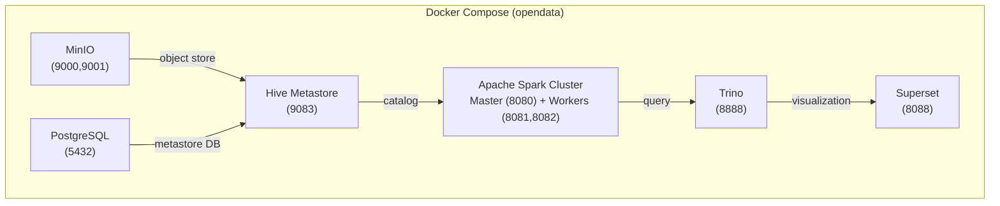
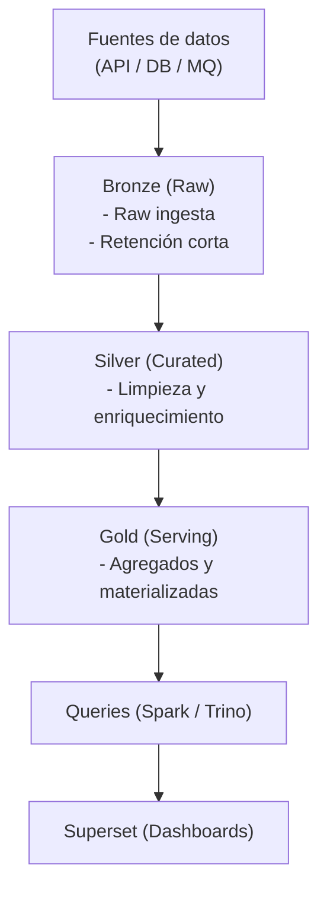

# ✅ Implementación Completada - OpenData

Resumen de todos los archivos y componentes implementados para el proyecto OpenData con Docker Compose, MinIO, Apache Iceberg y arquitectura medallion.

---

## 📦 Archivos Creados

### 📋 Documentación

#### 1. **doc/01_SPECS.md** (5.2 KB)
Especificación técnica completa que incluye:
- Stack tecnológico (Docker Compose, MinIO, Iceberg, Spark, Trino, Superset)
- Estructura de buckets en MinIO (bronze, silver, gold)
- Esquema de catálogo (Hive Metastore + PostgreSQL)
- Arquitectura medallion (capas Raw, Curated, Serving)
- Configuración de Apache Iceberg
- Componentes principales y requisitos de seguridad

#### 2. **doc/02_PLAN.md** (9.8 KB)
Plan de implementación fase por fase:
- **Fase 1**: Infraestructura Base (Docker Compose, servicios, variables)
- **Fase 2**: Configuración MinIO (buckets, prefijos, versionado)
- **Fase 3**: Configuración Iceberg (JARs, namespaces, Spark)
- **Fase 4**: Crear tablas medallion (Bronze, Silver, Gold)
- **Fase 5**: Ingesta y transformación (scripts Python)
- **Fase 6**: Validación y consultas (verificaciones)
- **Fase 7**: Visualización con Superset (dashboards)
- Checklist de verificación y pasos siguientes

#### 3. **QUICKSTART.md** (6.5 KB)
Guía rápida de inicio con:
- Requisitos previos
- Comandos paso a paso
- Interfaces de acceso (MinIO, Spark, Trino, Superset)
- Solución de problemas
- Ejemplos de consultas

---

### 🐳 Infraestructura Docker

#### 4. **docker/docker-compose.yml** (5.1 KB)
Orquestación completa con servicios:
- **PostgreSQL** (5432) - Base de datos para Hive Metastore
- **MinIO** (9000, 9001) - Almacenamiento S3-compatible
- **Hive Metastore** (9083) - Catálogo de metadatos
- **Spark Master** (7077, 8080) - Nodo maestro del cluster
- **Spark Worker 1 & 2** (8081, 8082) - Nodos trabajadores
- **Trino** (8888) - Motor de consultas SQL
- **Superset** (8088) - Visualización y BI
- **MinIO Init** - Inicializador de buckets

Características:
- Health checks configurados
- Volúmenes persistentes
- Networking personalizado
- Variables de entorno desde .env
- Dependencias entre servicios

#### 5. **docker/.env** (0.7 KB)
Variables de entorno:
- Credenciales PostgreSQL/MinIO/Superset
- URLs de endpoints
- Configuración de Spark, S3 e Iceberg

---

### ⚙️ Configuración de Servicios

#### 6. **config/spark/spark-defaults.conf** (2.1 KB)
Configuración de Apache Spark para Iceberg:
- Catálogo Iceberg (tipo Hive)
- Conexión a MinIO (S3)
- Extensiones Spark para Iceberg
- Opciones de rendimiento y memoria
- Configuración de compresión

#### 7. **config/trino/catalog/iceberg.properties** (0.6 KB)
Configuración de Trino para acceso a Iceberg:
- Connector Iceberg
- Metastore Hive
- Endpoints y credenciales S3

#### 8. **config/postgres/init.sql** (3.8 KB)
Script SQL de inicialización PostgreSQL:
- **Tablas de auditoría**:
  - `audit_operations` - operaciones en Iceberg
  - `schema_evolution` - cambios de esquema
  - `data_snapshots` - versionado de datos
  - `etl_executions` - ejecuciones de ETL
  - `data_quality_checks` - validaciones de calidad
- Índices para performance
- Vistas predefinidas
- Permisos de usuarios

---

### 🔧 Scripts de Utilidad

#### 9. **scripts/init-buckets.sh** (0.7 KB)
Script Bash para inicializar MinIO:
- Crear buckets (iceberg-data, warehouse, logs)
- Crear estructura de prefijos (bronze/, silver/, gold/)
- Habilitar versionado
- Verificación

#### 10. **scripts/create_iceberg_tables.py** (4.2 KB)
Script Python para crear tablas Iceberg:
- **Namespaces**: bronze, silver, gold
- **Tablas Bronze**: raw_events, raw_logs
- **Tablas Silver**: events, users
- **Tablas Gold**: daily_user_metrics, event_types_daily
- Configuración de particionado y compresión
- Verificación de creación

#### 11. **scripts/ingest_bronze_data.py** (4.1 KB)
Script de ingesta de datos a Bronze:
- Genera 1000 eventos de prueba
- Configura sesión Spark con Iceberg
- Ingiere a tabla bronze.raw_events
- Verifica datos y snapshots
- Muestra estadísticas

#### 12. **scripts/transform_silver_data.py** (3.9 KB)
Script de transformación Bronze → Silver:
- Lee datos de bronze.raw_events
- Aplica limpiezas y validaciones
- Enriquece con metadatos
- Escribe a silver.events
- Verifica distribución de eventos

#### 13. **scripts/aggregate_gold_data.py** (4.5 KB)
Script de agregación Silver → Gold:
- Crea métricas diarias por usuario
- Crea agregaciones por tipo de evento
- Escribe a gold.daily_user_metrics
- Escribe a gold.event_types_daily
- Verifica integridad de datos
- Muestra top usuarios y distribución

---

### 📄 Documentación Principal

#### 14. **README.md** (actualizado)
README del proyecto actualizado con:
- Stack tecnológico completo
- Estructura del repositorio
- Comandos de inicio rápido
- Enlaces a documentación

---

## 📊 Estadísticas

| Componente | Cantidad | Tamaño Aprox. |
|-----------|----------|---------------|
| Documentos | 3 | ~22 KB |
| Archivos Docker | 2 | ~6 KB |
| Configuraciones | 3 | ~7 KB |
| Scripts Python | 4 | ~17 KB |
| Scripts Bash | 1 | <1 KB |
| **Total** | **13** | **~53 KB** |

---

## 🏗️ Arquitectura Implementada

Data Flow:

---

## 🎯 Próximos Pasos Recomendados

1. **Validación Local**
   - [ ] Ejecutar `docker compose up -d` en directorio `docker/`
   - [ ] Verificar acceso a todas las interfaces
   - [ ] Ejecutar scripts en orden: create → ingest → transform → aggregate

2. **Integración ETL (Semana 5-6)**
   - [ ] Agregrar Apache Airflow para orquestación
   - [ ] Crear DAGs para pipelines diarios
   - [ ] Implementar validaciones de calidad de datos

3. **Optimización (Semana 6-7)**
   - [ ] Agregar índices y sort orders a Iceberg
   - [ ] Implementar políticas de retención
   - [ ] Optimizar compresión y particionado

4. **Monitoreo (Semana 7-8)**
   - [ ] Configurar logs centralizados
   - [ ] Agregar métricas de performance
   - [ ] Alertas de SLA

5. **Escalamiento (Semana 8+)**
   - [ ] Migrar a Kubernetes
   - [ ] Implementar HA para servicios críticos
   - [ ] Multi-región/backup

---

## 🚀 Recursos de Referencia

- **Apache Iceberg**: https://iceberg.apache.org/
- **MinIO**: https://min.io/
- **Apache Spark**: https://spark.apache.org/
- **Hive Metastore**: https://cwiki.apache.org/confluence/display/Hive/Design
- **Trino**: https://trino.io/
- **Docker Compose**: https://docs.docker.com/compose/

---

## 📝 Notas Importantes

1. **Seguridad**: Cambiar todas las contraseñas por defecto antes de desplegar en producción
2. **Persistencia**: Los volúmenes Docker persisten los datos entre reinicios
3. **Escalabilidad**: El diseño es escalable a Kubernetes siguiendo esta misma estructura
4. **Auditoría**: Todas las operaciones son registradas en PostgreSQL para cumplimiento normativo

---

**Implementación completada**: Mayo 2026  
**Versión**: 1.0  
**Estado**: ✅ Ready for Development
