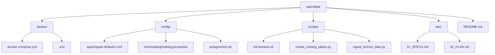

# 🚀 Inicio Rápido - OpenData

Guía para desplegar y ejecutar el entorno completo de analítica de datos.

---

## ✅ Requisitos Previos

- **Docker**: >= 20.10
- **Docker Compose**: >= 2.0
- **RAM disponible**: mínimo 8GB (recomendado 16GB)
- **Espacio en disco**: mínimo 20GB

---

## 📦 Estructura del Proyecto



---

## 🎯 Paso 1: Arrancar la Infraestructura

### 1.1 Cambiar a directorio Docker

```bash
cd opendata/docker
```

### 1.2 Iniciar servicios con Docker Compose

```bash
docker compose up -d
```

Esto inicia:
- PostgreSQL (puerto 5432)
- MinIO (puertos 9000, 9001)
- Hive Metastore (puerto 9083)
- Spark Master & Workers (puertos 7077, 8080, 8081, 8082)
- Trino (puerto 8888)
- Superset (puerto 8088)

### 1.3 Verificar que los servicios estén activos

```bash
docker compose ps
```

Deberías ver todos los servicios con estado `Up`.

### 1.4 Esperar a que los servicios estén listos

```bash
# Verificar PostgreSQL
docker compose logs postgres | grep "ready to accept"

# Verificar MinIO
docker compose logs minio | grep "Ready"

# Verificar Hive Metastore
docker compose logs hive-metastore | grep "Started HiveMetaStore"
```

---

## 🗂️ Paso 2: Inicializar Buckets en MinIO

### 2.1 Acceder a MinIO UI

Abre en tu navegador: [http://localhost:9001](http://localhost:9001)

- Usuario: `minioadmin`
- Contraseña: `changeme123!` (cambiar en producción)

### 2.2 Crear buckets (alternativa: ejecutar script)

```bash
cd ../scripts
bash init-buckets.sh
```

Deberías ver:
```
✅ Inicialización de buckets completada
```

---

## 📊 Paso 3: Crear Tablas Iceberg

### 3.1 Ejecutar script de creación de tablas

```bash
docker compose -f docker-compose.yml exec spark-master \
  spark-submit \
  --master spark://spark-master:7077 \
  --packages org.apache.iceberg:iceberg-spark-runtime-3.3_2.12:1.3.1,org.apache.hadoop:hadoop-aws:3.3.4,software.amazon.awssdk:bundle:2.20.0 \
  --conf spark.sql.catalog.iceberg=org.apache.iceberg.spark.SparkCatalog \
  --conf spark.sql.catalog.iceberg.type=hive \
  --conf spark.sql.catalog.iceberg.uri=thrift://hive-metastore:9083 \
  --conf spark.sql.catalog.iceberg.warehouse=s3a://iceberg-data \
  --conf spark.hadoop.fs.s3a.endpoint=http://minio:9000 \
  --conf spark.hadoop.fs.s3a.access.key=minioadmin \
  --conf spark.hadoop.fs.s3a.secret.key=changeme123! \
  --conf spark.hadoop.fs.s3a.path.style.access=true \
  /scripts/create_iceberg_tables.py
```

Deberías ver:
```
✅ Namespaces creados exitosamente
✅ Tabla bronze.raw_events creada
✅ Tabla silver.events creada
✅ Tabla gold.daily_user_metrics creada
✅ Creación de tablas completada exitosamente
```

---

## 📥 Paso 4: Ingestar Datos a Bronze

### 4.1 Ejecutar script de ingesta

```bash
docker compose -f docker-compose.yml exec spark-master \
  spark-submit \
  --master spark://spark-master:7077 \
  --packages org.apache.iceberg:iceberg-spark-runtime-3.3_2.12:1.3.1,org.apache.hadoop:hadoop-aws:3.3.4,software.amazon.awssdk:bundle:2.20.0 \
  --conf spark.sql.catalog.iceberg=org.apache.iceberg.spark.SparkCatalog \
  --conf spark.sql.catalog.iceberg.type=hive \
  --conf spark.sql.catalog.iceberg.uri=thrift://hive-metastore:9083 \
  --conf spark.sql.catalog.iceberg.warehouse=s3a://iceberg-data \
  --conf spark.hadoop.fs.s3a.endpoint=http://minio:9000 \
  --conf spark.hadoop.fs.s3a.access.key=minioadmin \
  --conf spark.hadoop.fs.s3a.secret.key=changeme123! \
  --conf spark.hadoop.fs.s3a.path.style.access=true \
  /scripts/ingest_bronze_data.py
```

Deberías ver:
```
Generando 1000 eventos de prueba...
✅ 1000 eventos generados
✅ 1000 eventos ingiridos exitosamente
```

---

## 🔍 Paso 5: Verificar Datos

### 5.1 Acceder a Spark SQL

```bash
docker compose -f docker-compose.yml exec spark-master spark-sql
```

### 5.2 Ejecutar consultas

```sql
-- Ver datos ingiridos en Bronze
SELECT COUNT(*) as total_events FROM bronze.raw_events;

-- Ver últimos eventos
SELECT event_id, event_time, source_system, user_id 
FROM bronze.raw_events 
LIMIT 5;

-- Ver estadísticas por fuente
SELECT source_system, COUNT(*) as count 
FROM bronze.raw_events 
GROUP BY source_system;
```

---

## 📊 Paso 6: Consultar con Trino (Opcional)

### 6.1 Acceder a Trino

```bash
docker compose -f docker-compose.yml exec trino trino --catalog iceberg --schema bronze
```

### 6.2 Ejecutar consulta

```sql
SELECT source_system, COUNT(*) as event_count 
FROM raw_events 
GROUP BY source_system;
```

---

## 📈 Paso 7: Visualizar en Superset (Opcional)

### 7.1 Acceder a Superset

Abre en tu navegador: [http://localhost:8088](http://localhost:8088)

- Usuario: `admin`
- Contraseña: `admin123` (cambiar en producción)

### 7.2 Agregar conexión a Trino

1. Ve a **Settings** → **Database Connections**
2. Haz clic en **New**
3. Selecciona **Trino**
4. Completa:
   - **Host**: `trino`
   - **Port**: `8080`
   - **Catalog**: `iceberg`
   - **Schema**: `bronze`

### 7.3 Crear dashboard

1. Crea una nuevo dataset desde `bronze.raw_events`
2. Crea visualizaciones (gráficos de barras, líneas, etc.)
3. Agrega al dashboard

---

## 🛑 Detener la Infraestructura

```bash
docker compose down -v  # Eliminar volúmenes también
```

---

## 📋 Interfaces de Acceso

| Servicio | URL | Usuario | Contraseña |
|----------|-----|---------|-----------|
| MinIO UI | http://localhost:9001 | minioadmin | changeme123! |
| Spark Master | http://localhost:8080 | - | - |
| Spark Worker 1 | http://localhost:8081 | - | - |
| Spark Worker 2 | http://localhost:8082 | - | - |
| Trino | http://localhost:8888 | - | - |
| Superset | http://localhost:8088 | admin | admin123 |

---

## 🐛 Solución de Problemas

### Los servicios no arrancan

```bash
# Ver logs
docker compose logs [servicio]

# Ejemplo: ver logs de Hive Metastore
docker compose logs hive-metastore
```

### MinIO no está accesible

```bash
# Verificar que MinIO está corriendo
docker compose ps minio

# Ver logs de MinIO
docker compose logs minio
```

### Spark no puede conectar a MinIO

```bash
# Verificar conectividad desde Spark
docker compose -f docker-compose.yml exec spark-master \
  hadoop fs -ls s3a://iceberg-data/
```

### Las tablas Iceberg no se crean

```bash
# Verificar Hive Metastore
docker compose logs hive-metastore

# Verificar PostgreSQL
docker compose logs postgres
```

---

## 📚 Documentación Adicional

- [01_SPECS.md](../doc/01_SPECS.md) - Especificaciones técnicas detalladas
- [02_PLAN.md](../doc/02_PLAN.md) - Plan de implementación completo

---

## ⚙️ Personalización

### Cambiar contraseñas

Edita `docker/.env` antes de iniciar los servicios:

```env
POSTGRES_PASSWORD=tu_contraseña
MINIO_ROOT_PASSWORD=tu_contraseña
```

### Ajustar recursos de Spark

En `docker-compose.yml`:

```yaml
spark-master:
  environment:
    SPARK_DRIVER_MEMORY: 4g
    SPARK_EXECUTOR_MEMORY: 4g
```

---

**Versión**: 1.0  
**Última actualización**: Mayo 2026
