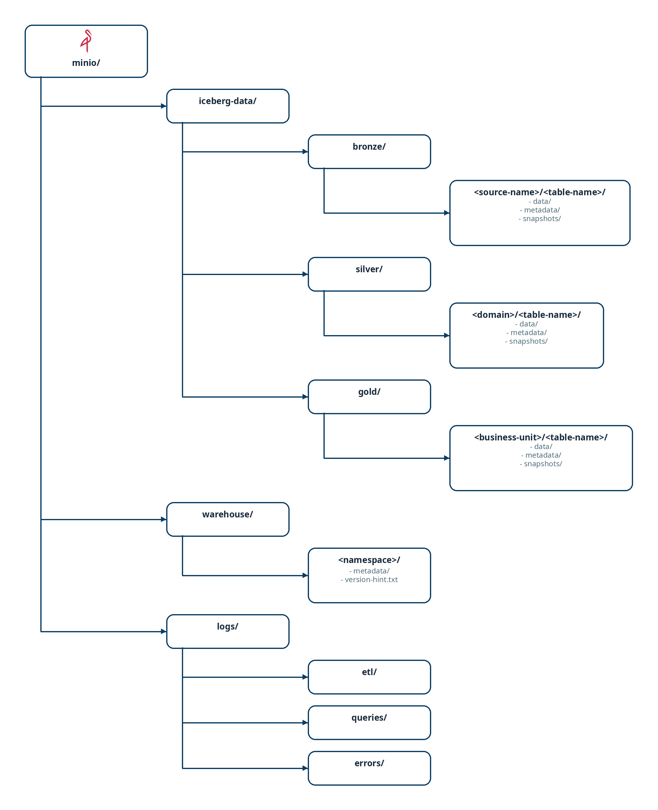

# 📋 Especificaciones Técnicas - OpenData

## Descripción General

Este documento define la arquitectura técnica del entorno de analítica de datos **OpenData**, incluyendo infraestructura, almacenamiento, catálogo y arquitectura medallion.

---

## 🏗️ Infraestructura Principal

### Stack Tecnológico

| Componente | Tecnología | Propósito |
|---|---|---|
| **Infraestructura** | Docker Compose | Orquestación y despliegue local/on-prem |
| **Almacenamiento de Objetos** | MinIO | Backend S3-compatible para datos |
| **Formato de Tabla** | Apache Iceberg | Capa ACID, versionado y evolución de esquema |
| **Catálogo de Metadatos** | Hive Metastore + PostgreSQL | Registro centralizado de tablas |
| **Motor de Procesamiento** | Apache Spark / Trino | Ingesta, transformación y consultas |
| **Orquestación ETL** | Apache Airflow / dbt | Pipelines y automatización |
| **Visualización** | Apache Superset / Metabase | BI y dashboarding |
| **Gobierno del Dato** | OpenMetadata + Elasticsearch | Catálogo, linaje, calidad y glosario |

---

## 🗂️ Almacenamiento de Objetos (MinIO)

### Estructura de Buckets


<br>
*Estructura de buckets en MinIO (iceberg-data, warehouse, logs) Fuente editable en draw.io: [../drawio/specs-buckets.drawio](../drawio/specs-buckets.drawio).*

### Configuración de Acceso

- **MINIO_ROOT_USER**: `minioadmin`
- **MINIO_ROOT_PASSWORD**: cambiar en producción
- **Puertos**: 
  - API S3: `9000`
  - UI: `9001`

---

## 🗃️ Catálogo de Metadatos

### Componentes del Catálogo

#### 1. Hive Metastore
- Almacena definiciones de bases de datos, tablas y particiones
- Conectado a PostgreSQL para persistencia
- Expone un servicio Thrift en puerto `9083`

#### 2. Base de Datos de Metadatos (PostgreSQL)
- Persistencia de tablas y propiedades
- Auditoría y versionado de cambios de esquema
- Puerto: `5432`

### Esquema de Tabla Iceberg

Cada tabla registra:

```json
{
  "table_name": "events",
  "namespace": "bronze",
  "location": "s3a://iceberg-data/bronze/events/",
  "schema": {
    "type": "struct",
    "fields": [
      { "id": 1, "name": "event_id", "required": true, "type": "string" },
      { "id": 2, "name": "event_time", "required": true, "type": "timestamp" },
      { "id": 3, "name": "user_id", "required": false, "type": "string" },
      { "id": 4, "name": "properties", "required": false, "type": "map<string,string>" }
    ]
  },
  "partition_spec": [
    { "name": "year", "transform": "year", "source_id": 2 },
    { "name": "month", "transform": "month", "source_id": 2 }
  ],
  "properties": {
    "write.format.default": "parquet",
    "write.parquet.compression-codec": "snappy",
    "write.metadata.compression-codec": "gzip",
    "write.delete.mode": "merge-on-read"
  },
  "format_version": 2,
  "created_at": "2026-05-10T10:00:00Z",
  "last_modified": "2026-05-10T10:00:00Z"
}
```

### Tablas de Auditoría

```sql
CREATE TABLE audit_operations (
  id BIGSERIAL PRIMARY KEY,
  table_namespace VARCHAR(255),
  table_name VARCHAR(255),
  operation_type VARCHAR(50),  -- CREATE, UPDATE, DELETE, MERGE, UPSERT
  snapshot_id BIGINT,
  committed_at TIMESTAMP,
  file_count INT,
  rows_affected BIGINT,
  metadata_changed BOOLEAN,
  user_id VARCHAR(255),
  created_at TIMESTAMP DEFAULT NOW()
);

CREATE TABLE schema_evolution (
  id BIGSERIAL PRIMARY KEY,
  table_namespace VARCHAR(255),
  table_name VARCHAR(255),
  schema_id INT,
  schema_json TEXT,
  change_type VARCHAR(50),  -- ADD, DROP, RENAME, REORDER, UPDATE_TYPE
  change_details TEXT,
  applied_at TIMESTAMP,
  created_at TIMESTAMP DEFAULT NOW()
);
```

---

## 🏛️ Gobierno del Dato (OpenMetadata)

### Propósito

Centralizar el **catálogo de datos** (tablas Iceberg, esquemas, propietarios), el **linaje** (Bronze → Silver → Gold, DAGs de Airflow), los **tests de calidad** y el **glosario de negocio** en una única UI.

### Componentes Desplegados (solo `docker-compose.yml` completo)

| Servicio | Imagen | Puertos | Propósito |
|---|---|---|---|
| `elasticsearch` | `docker.elastic.co/elasticsearch/elasticsearch:9.3.0` | `9200`, `9300` | Índice de búsqueda del catálogo |
| `openmetadata-migrate` | `docker.getcollate.io/openmetadata/server:1.12.14` | — | Job one-shot de migración de esquema |
| `openmetadata-server` | `docker.getcollate.io/openmetadata/server:1.12.14` | `8585` (UI/API), `8586` (admin) | Catálogo, glosario, linaje, calidad |
| `openmetadata-ingestion` | `docker.getcollate.io/openmetadata/ingestion:1.12.14` | `8090` → `8080` | Airflow standalone para ingestas de metadatos |

- **Backend relacional**: reutiliza el PostgreSQL del stack (`openmetadata_db`, rol `openmetadata`, creados por `config/postgres/init-openmetadata.sql`).
- **Backend del ingestion**: BBDD `openmetadata_ingestion_db` en el mismo PostgreSQL.
- **Acceso por defecto**: UI en `http://localhost:8585` con `admin@open-metadata.org` / `admin` (cambiar en producción).
- **Requisitos**: el conjunto Elasticsearch + OpenMetadata exige ~6 GiB RAM y 4 vCPU; **no** está incluido en el perfil `docker-compose.lite.yml`.

### Conectores Recomendados

1. **Hive Metastore** (`thrift://hive-metastore:9083`): ingiere namespaces bronze/silver/gold, esquemas y propiedades de las tablas Iceberg.
2. **Trino** (`trino:8080`, catálogo `iceberg`): expone las tablas para exploración y profiling desde OpenMetadata.
3. **Airflow** (`http://airflow-webserver:8080`): linaje de los DAGs ETL hacia las tablas que leen/escriben.
4. **Superset** (`http://superset:8088`): ingiere dashboards y charts para trazar consumo Gold → BI.
5. **dbt** (futuro): tests y documentación como fuente de calidad y descripciones.

---

## 🎨 Arquitectura Medallion

### Capa Bronze (Raw)

**Propósito**: Capturar datos crudos sin transformaciones, manteniendo trazabilidad completa.

**Características**:
- Datos ingieren tal como vienen de la fuente
- Particionado por fecha/evento (`year/month/day`)
- Retención: típicamente 90-180 días
- Compresión: Snappy (balance entre rendimiento y ratio)

**Ejemplo de tabla**:
```sql
CREATE TABLE bronze.raw_events (
  event_id STRING,
  event_time TIMESTAMP,
  source_system STRING,
  raw_payload STRING,      -- JSON o datos sin procesar
  ingestion_time TIMESTAMP,
  file_name STRING
)
USING ICEBERG
PARTITIONED BY (year(event_time), month(event_time), day(event_time))
```

**Ruta en MinIO**: `s3a://iceberg-data/bronze/<source>/<table>/`

---

### Capa Silver (Curated)

**Propósito**: Datos limpios, enriquecidos, validados y deduplicados, listos para análisis.

**Características**:
- Transformaciones: normalización, deduplicación, enriquecimiento
- Validaciones de calidad de datos
- Particionado por dominio de negocio
- Retención: típicamente 1-2 años
- Compresión: Parquet con Snappy

**Ejemplo de tabla**:
```sql
CREATE TABLE silver.events (
  event_id STRING,
  event_time TIMESTAMP,
  user_id STRING,
  event_type STRING,
  event_category STRING,
  properties MAP<STRING, STRING>,
  created_at TIMESTAMP,
  updated_at TIMESTAMP
)
USING ICEBERG
PARTITIONED BY (year(event_time), month(event_time))
```

**Ruta en MinIO**: `s3a://iceberg-data/silver/<domain>/<table>/`

---

### Capa Gold (Serving)

**Propósito**: Datos agregados y optimizados para consumo directo por BI, reporting y aplicaciones.

**Características**:
- Tablas materializadas y pre-agregadas
- Denormalizadas para queries rápidas
- Índices, sort orders y z-ordering
- Retención: histórico completo, típicamente 2-5 años
- Compresión: Parquet con Snappy + índices

**Ejemplo de tabla**:
```sql
CREATE TABLE gold.daily_user_metrics (
  date DATE,
  user_id STRING,
  total_events INT,
  unique_event_types INT,
  first_event_time TIMESTAMP,
  last_event_time TIMESTAMP,
  created_at TIMESTAMP
)
USING ICEBERG
PARTITIONED BY (year(date), month(date))
```

**Ruta en MinIO**: `s3a://iceberg-data/gold/<business_unit>/<table>/`

---

## 📊 Flujo de Datos

```
Fuentes de datos
       ↓
   [Ingestor - Spark/Airbyte]
       ↓
   Bronze Layer (Raw)
       ↓
   [Transformador - Spark/dbt]
       ↓
   Silver Layer (Curated)
       ↓
   [Agregador - Spark/SQL]
       ↓
   Gold Layer (Serving)
       ↓
   [BI Tools - Superset/Metabase]
       ↓
   Dashboards y Reports
```

---

## 🔗 Configuración de Apache Iceberg

### Propiedades Globales

```properties
# Catálogo
spark.sql.catalog.iceberg=org.apache.iceberg.spark.SparkCatalog
spark.sql.catalog.iceberg.type=hive
spark.sql.catalog.iceberg.uri=thrift://hive-metastore:9083
spark.sql.catalog.iceberg.warehouse=s3a://iceberg-data

# S3 / MinIO
spark.hadoop.fs.s3a.endpoint=http://minio:9000
spark.hadoop.fs.s3a.access.key=minioadmin
spark.hadoop.fs.s3a.secret.key=minioadmin
spark.hadoop.fs.s3a.path.style.access=true
spark.hadoop.fs.s3a.connection.ssl.enabled=false

# Iceberg defaults
spark.sql.extensions=org.apache.iceberg.spark.extensions.IcebergSparkSessionExtensions
spark.sql.defaultCatalog=iceberg

# Performance
spark.sql.iceberg.write.use-table-distribution=true
spark.sql.iceberg.write.shuffle-by-partition-id=true
```

---

## 📦 Componentes Principales

### 1. MinIO
- Almacenamiento S3-compatible
- Interfaz web para administración
- Replicación y políticas de ciclo de vida

### 2. PostgreSQL + Hive Metastore
- Catálogo centralizado
- Auditoría de cambios
- Gestión de esquemas y particiones

### 3. Apache Spark
- Procesamiento batch distribuido
- Integración nativa con Iceberg
- Soporte para SQL, Python y Scala

### 4. Trino (opcional)
- Consultas SQL interactivas sin Spark
- Federación de múltiples fuentes
- Mejor rendimiento para queries ad-hoc

### 5. Apache Airflow (opcional)
- Orquestación de DAGs ETL
- Monitoreo y alertas
- Control de dependencias
- Ejemplo de DAG en `docker/airflow/dags/opendata_example_dag.py`
- Wrapper de pipeline en `scripts/run_etl_pipeline.sh`

### 6. OpenMetadata + Elasticsearch (opcional)
- Catálogo centralizado de tablas Iceberg, glosario y linaje
- Ingestión de metadatos desde Hive, Trino, Airflow y Superset
- Tests de calidad y profiling sobre las capas medallion
- Solo en `docker-compose.yml` completo (requiere ~6 GiB RAM)

---

## 🔐 Seguridad y Auditoría

- **Acceso a MinIO**: credenciales de IAM local
- **Acceso a base de datos**: PostgreSQL con usuarios dedicados por aplicación
- **Logs**: registrados en MinIO bucket `logs/`
- **Auditoría**: tabla `audit_operations` en PostgreSQL
- **Versionado**: snapshots de Iceberg mantienen historial de cambios

---

## 📈 Escalabilidad

- **Local/Dev**: Docker Compose en máquina de desarrollador
- **On-prem pequeño**: Docker Compose en servidor único
- **On-prem mediano**: Docker Swarm o Kubernetes con múltiples nodos
- **Producción**: Kubernetes con separación de cargas (controlplane, data, analytics)

---

**Versión**: 1.0  
**Última actualización**: Mayo 2026
