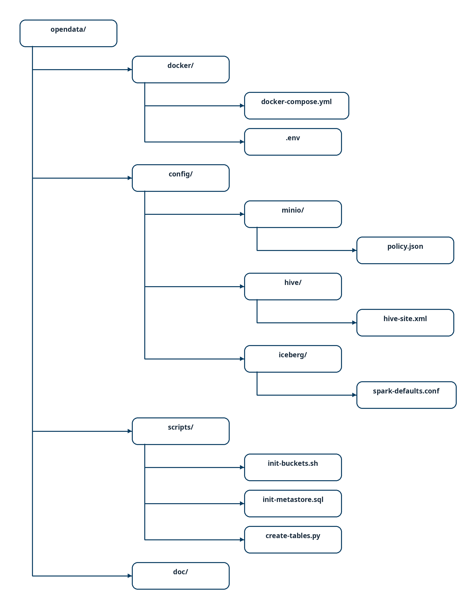
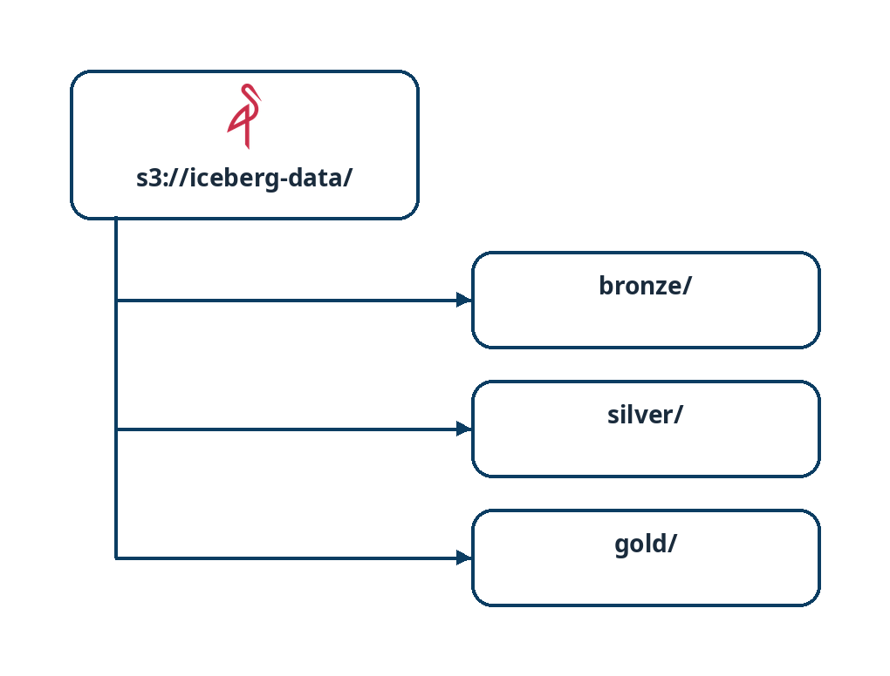

# 📋 Plan de Implementación - OpenData

## Descripción

Plan de implementación paso a paso para desplegar un entorno completo de analítica de datos con Docker Compose, MinIO, Apache Iceberg y arquitectura medallion.

---

## 🎯 Objetivos

1. ✅ Desplegar infraestructura local con Docker Compose
2. ✅ Configurar MinIO para almacenamiento de objetos
3. ✅ Establecer catálogo de metadatos con Hive Metastore + PostgreSQL
4. ✅ Crear estructura de capas Bronze/Silver/Gold en Iceberg
5. ✅ Validar ingesta, transformación y consultas de datos
6. ✅ Documentar flujos y procedimientos operacionales

---

## 📅 Fases de Implementación

### Fase 1: Infraestructura Base (Semana 1-2)

#### 1.1 Preparación del Entorno

- [ ] Revisar requisitos de sistema: Docker, Docker Compose >= 2.0, 8GB RAM mínimo
- [ ] Clonar/descargar el repositorio `opendata`
- [ ] Crear estructura de directorios:
  
<br>
*Estructura de directorios planificada del proyecto Fuente editable en draw.io: [../drawio/plan-structure.drawio](../drawio/plan-structure.drawio).*

#### 1.2 Despliegue de Docker Compose

- [ ] Crear `docker-compose.yml` con servicios:
  - MinIO (9000, 9001)
  - PostgreSQL (5432)
  - Hive Metastore (9083)
  - Spark (standalone o cluster)
  - Trino (opcional, 8080)
  - Superset (opcional, 8088)
  - Elasticsearch (opcional, 9200)
  - OpenMetadata Server (opcional, 8585) + Ingestion (opcional, 8090)

- [ ] Crear archivo `.env` con variables:
  ```env
  MINIO_ROOT_USER=minioadmin
  MINIO_ROOT_PASSWORD=changeme123!
  POSTGRES_USER=opendata
  POSTGRES_PASSWORD=changeme123!
  POSTGRES_DB=hive_metastore
  SPARK_MASTER=spark://spark-master:7077
  ```

- [ ] Verificar que todos los servicios se inician correctamente:
  ```bash
  docker compose -f docker/docker-compose.yml up -d
  docker compose ps
  ```

- [ ] Validar acceso a interfaces:
  - MinIO UI: http://localhost:9001
  - Hive Metastore: nc -zv localhost 9083
  - PostgreSQL: psql -U opendata -h localhost -d hive_metastore

---

### Fase 2: Configuración de Almacenamiento (Semana 2)

#### 2.1 Configurar MinIO

- [ ] Acceder a MinIO UI (http://localhost:9001)
- [ ] Crear buckets:
  ```bash
  aws s3 mb s3://iceberg-data --endpoint-url http://localhost:9000
  aws s3 mb s3://warehouse --endpoint-url http://localhost:9000
  aws s3 mb s3://logs --endpoint-url http://localhost:9000
  ```

- [ ] Verificar estructura de prefijos:
  
<br>
*Prefijos bronze, silver y gold en s3://iceberg-data/ Fuente editable en draw.io: [../drawio/plan-buckets.drawio](../drawio/plan-buckets.drawio).*

#### 2.2 Inicializar Base de Datos de Metadatos

- [ ] Conectar a PostgreSQL:
  ```bash
  docker compose -f docker/docker-compose.yml exec postgres psql -U opendata -d hive_metastore
  ```

- [ ] Ejecutar script de inicialización:
  ```sql
  -- Crear tablas base de Hive Metastore (automático con esquinit)
  -- Crear tablas de auditoría
  CREATE TABLE audit_operations (
    id BIGSERIAL PRIMARY KEY,
    table_namespace VARCHAR(255),
    table_name VARCHAR(255),
    operation_type VARCHAR(50),
    snapshot_id BIGINT,
    committed_at TIMESTAMP,
    file_count INT,
    rows_affected BIGINT,
    metadata_changed BOOLEAN,
    user_id VARCHAR(255),
    created_at TIMESTAMP DEFAULT NOW()
  );
  
  CREATE TABLE schema_evolution (
    id BIGSERIAL PRIMARY KEY,
    table_namespace VARCHAR(255),
    table_name VARCHAR(255),
    schema_id INT,
    schema_json TEXT,
    change_type VARCHAR(50),
    change_details TEXT,
    applied_at TIMESTAMP,
    created_at TIMESTAMP DEFAULT NOW()
  );
  ```

- [ ] Crear índices:
  ```sql
  CREATE INDEX idx_audit_ops_table ON audit_operations(table_namespace, table_name, committed_at DESC);
  CREATE INDEX idx_schema_evo_table ON schema_evolution(table_namespace, table_name, applied_at DESC);
  ```

---

### Fase 3: Configuración de Iceberg (Semana 2-3)

#### 3.1 Preparar Spark para Iceberg

- [ ] Descargar JARs de Iceberg:
  ```bash
  # Incluir en SPARK_JARS en docker-compose.yml
  org.apache.iceberg:iceberg-spark-runtime-3.3_2.12:1.3.1
  org.apache.hadoop:hadoop-aws:3.3.4
  software.amazon.awssdk:bundle:2.20.0
  ```

- [ ] Configurar variables de entorno en Spark:
  ```properties
  spark.sql.catalog.iceberg=org.apache.iceberg.spark.SparkCatalog
  spark.sql.catalog.iceberg.type=hive
  spark.sql.catalog.iceberg.uri=thrift://hive-metastore:9083
  spark.sql.catalog.iceberg.warehouse=s3a://iceberg-data
  
  spark.hadoop.fs.s3a.endpoint=http://minio:9000
  spark.hadoop.fs.s3a.access.key=minioadmin
  spark.hadoop.fs.s3a.secret.key=minioadmin
  spark.hadoop.fs.s3a.path.style.access=true
  ```

#### 3.2 Crear Bases de Datos en Iceberg

- [ ] Conectar a Spark SQL:
  ```bash
  docker compose -f docker/docker-compose.yml exec spark-master spark-sql
  ```

- [ ] Crear namespaces:
  ```sql
  CREATE NAMESPACE bronze;
  CREATE NAMESPACE silver;
  CREATE NAMESPACE gold;
  ```

- [ ] Verificar:
  ```sql
  SHOW NAMESPACES;
  ```

---

### Fase 4: Crear Tablas Medallion (Semana 3)

#### 4.1 Capa Bronze (Raw)

- [ ] Crear tabla de ejemplo:
  ```sql
  CREATE TABLE IF NOT EXISTS bronze.raw_events (
    event_id STRING,
    event_time TIMESTAMP,
    source_system STRING,
    user_id STRING,
    raw_payload STRING,
    ingestion_time TIMESTAMP,
    file_name STRING
  )
  USING ICEBERG
  PARTITIONED BY (year(event_time), month(event_time), day(event_time))
  LOCATION 's3a://iceberg-data/bronze/raw_events/'
  TBLPROPERTIES (
    'write.format.default'='parquet',
    'write.parquet.compression-codec'='snappy'
  );
  ```

- [ ] Verificar creación:
  ```sql
  SELECT * FROM bronze.raw_events;
  ```

#### 4.2 Capa Silver (Curated)

- [ ] Crear tabla transformada:
  ```sql
  CREATE TABLE IF NOT EXISTS silver.events (
    event_id STRING,
    event_time TIMESTAMP,
    user_id STRING,
    event_type STRING,
    event_category STRING,
    properties MAP<STRING, STRING>,
    created_at TIMESTAMP,
    updated_at TIMESTAMP
  )
  USING ICEBERG
  PARTITIONED BY (year(event_time), month(event_time))
  LOCATION 's3a://iceberg-data/silver/events/'
  TBLPROPERTIES (
    'write.format.default'='parquet',
    'write.parquet.compression-codec'='snappy'
  );
  ```

#### 4.3 Capa Gold (Serving)

- [ ] Crear tabla agregada:
  ```sql
  CREATE TABLE IF NOT EXISTS gold.daily_user_metrics (
    date DATE,
    user_id STRING,
    total_events INT,
    unique_event_types INT,
    first_event_time TIMESTAMP,
    last_event_time TIMESTAMP,
    created_at TIMESTAMP
  )
  USING ICEBERG
  PARTITIONED BY (year(date), month(date))
  LOCATION 's3a://iceberg-data/gold/daily_user_metrics/'
  TBLPROPERTIES (
    'write.format.default'='parquet',
    'write.parquet.compression-codec'='snappy'
  );
  ```

---

### Fase 5: Ingesta y Transformación de Datos (Semana 3-4)

#### 5.1 Crear Script de Ingesta (Bronze)

- [ ] Crear `scripts/ingest_bronze.py`:
  ```python
  from pyspark.sql import SparkSession
  from datetime import datetime, timedelta
  import random
  
  spark = SparkSession.builder \
      .appName("bronze_ingest") \
      .config("spark.sql.catalog.iceberg", "org.apache.iceberg.spark.SparkCatalog") \
      .config("spark.sql.catalog.iceberg.type", "hive") \
      .config("spark.sql.catalog.iceberg.uri", "thrift://hive-metastore:9083") \
      .config("spark.sql.catalog.iceberg.warehouse", "s3a://iceberg-data") \
      .config("spark.hadoop.fs.s3a.endpoint", "http://minio:9000") \
      .config("spark.hadoop.fs.s3a.access.key", "minioadmin") \
      .config("spark.hadoop.fs.s3a.secret.key", "minioadmin") \
      .config("spark.hadoop.fs.s3a.path.style.access", "true") \
      .getOrCreate()
  
  # Generar datos de prueba
  data = []
  for i in range(1000):
      data.append((
          f"event_{i}",
          datetime.now() - timedelta(days=random.randint(0, 30)),
          f"source_{random.randint(1, 5)}",
          f"user_{random.randint(1, 100)}",
          f'{{"key": "value_{i}"}}',
          datetime.now(),
          "test_file.json"
      ))
  
  df = spark.createDataFrame(data, 
      ["event_id", "event_time", "source_system", "user_id", "raw_payload", "ingestion_time", "file_name"])
  
  df.write \
      .mode("append") \
      .format("iceberg") \
      .saveAsTable("bronze.raw_events")
  
  print("Ingesta completada")
  spark.stop()
  ```

- [ ] Ejecutar ingesta:
  ```bash
  docker compose -f docker/docker-compose.yml exec spark-master spark-submit /scripts/ingest_bronze_data.py
  ```

- [ ] Ejecutar pipeline completo de carga:
  ```bash
  bash scripts/run_etl_pipeline.sh
  ```

> Nota: También se incluye un DAG de Airflow (`docker/airflow/dags/opendata_example_dag.py`) llamado `opendata_etl_pipeline` que ejecuta `run_etl_pipeline.sh`. Puedes activar y programar este DAG desde la UI de Airflow en `http://localhost:8085` o desencadenarlo con la CLI:

```bash
docker compose -f docker/docker-compose.yml exec airflow-webserver \
  airflow dags trigger opendata_etl_pipeline
```

#### 5.2 Crear Pipeline de Transformación (Bronze → Silver)

- [ ] Crear `scripts/transform_silver.py`:
  ```python
  from pyspark.sql import SparkSession
  from pyspark.sql.functions import col, from_json, schema_of_json, lit
  import json
  
  spark = SparkSession.builder \
      .appName("silver_transform") \
      .config("spark.sql.catalog.iceberg", "org.apache.iceberg.spark.SparkCatalog") \
      .config("spark.sql.catalog.iceberg.type", "hive") \
      .config("spark.sql.catalog.iceberg.uri", "thrift://hive-metastore:9083") \
      .config("spark.sql.catalog.iceberg.warehouse", "s3a://iceberg-data") \
      .config("spark.hadoop.fs.s3a.endpoint", "http://minio:9000") \
      .config("spark.hadoop.fs.s3a.access.key", "minioadmin") \
      .config("spark.hadoop.fs.s3a.secret.key", "minioadmin") \
      .config("spark.hadoop.fs.s3a.path.style.access", "true") \
      .getOrCreate()
  
  # Leer desde Bronze
  bronze_df = spark.table("bronze.raw_events")
  
  # Transformaciones
  silver_df = bronze_df \
      .filter(col("event_id").isNotNull()) \
      .withColumn("event_type", lit("default")) \
      .withColumn("event_category", lit("unclassified")) \
      .withColumn("properties", lit({})) \
      .withColumn("created_at", col("ingestion_time")) \
      .withColumn("updated_at", col("ingestion_time")) \
      .select("event_id", "event_time", "user_id", "event_type", "event_category", "properties", "created_at", "updated_at")
  
  # Escribir a Silver
  silver_df.write \
      .mode("append") \
      .format("iceberg") \
      .saveAsTable("silver.events")
  
  print("Transformación completada")
  spark.stop()
  ```

#### 5.3 Crear Agregaciones (Silver → Gold)

- [ ] Crear `scripts/aggregate_gold.py`:
  ```python
  from pyspark.sql import SparkSession
  from pyspark.sql.functions import col, count, countDistinct, min, max, to_date, lit, current_timestamp
  
  spark = SparkSession.builder \
      .appName("gold_aggregate") \
      .config("spark.sql.catalog.iceberg", "org.apache.iceberg.spark.SparkCatalog") \
      .config("spark.sql.catalog.iceberg.type", "hive") \
      .config("spark.sql.catalog.iceberg.uri", "thrift://hive-metastore:9083") \
      .config("spark.sql.catalog.iceberg.warehouse", "s3a://iceberg-data") \
      .config("spark.hadoop.fs.s3a.endpoint", "http://minio:9000") \
      .config("spark.hadoop.fs.s3a.access.key", "minioadmin") \
      .config("spark.hadoop.fs.s3a.secret.key", "minioadmin") \
      .config("spark.hadoop.fs.s3a.path.style.access", "true") \
      .getOrCreate()
  
  # Leer desde Silver
  silver_df = spark.table("silver.events")
  
  # Agregaciones diarias
  gold_df = silver_df \
      .withColumn("date", to_date(col("event_time"))) \
      .groupBy("date", "user_id") \
      .agg(
          count("event_id").alias("total_events"),
          countDistinct("event_type").alias("unique_event_types"),
          min("event_time").alias("first_event_time"),
          max("event_time").alias("last_event_time")
      ) \
      .withColumn("created_at", current_timestamp())
  
  # Escribir a Gold
  gold_df.write \
      .mode("append") \
      .format("iceberg") \
      .saveAsTable("gold.daily_user_metrics")
  
  print("Agregación completada")
  spark.stop()
  ```

#### 5.4 Pipeline de Carga Completo

- [ ] Crear `scripts/run_etl_pipeline.sh`:
  ```bash
  #!/usr/bin/env bash
  set -euo pipefail

  ROOT_DIR="$(cd "$(dirname "${BASH_SOURCE[0]}")/.." && pwd)"
  cd "$ROOT_DIR"

  docker compose -f docker/docker-compose.yml exec -T spark-master spark-submit /scripts/create_iceberg_tables.py
  docker compose -f docker/docker-compose.yml exec -T spark-master spark-submit /scripts/ingest_bronze_data.py
  docker compose -f docker/docker-compose.yml exec -T spark-master spark-submit /scripts/transform_silver_data.py
  docker compose -f docker/docker-compose.yml exec -T spark-master spark-submit /scripts/aggregate_gold_data.py
  ```

- [ ] Ejecutar el pipeline completo:
  ```bash
  bash scripts/run_etl_pipeline.sh
  ```

---

### Fase 6: Validación y Consultas (Semana 4)

#### 6.1 Consultas de Validación

- [ ] Ejecutar consultas en Spark SQL:
  ```sql
  -- Verificar datos en Bronze
  SELECT COUNT(*) as total_events FROM bronze.raw_events;
  SELECT * FROM bronze.raw_events LIMIT 5;
  
  -- Verificar transformaciones en Silver
  SELECT COUNT(*) as total_events FROM silver.events;
  SELECT event_type, COUNT(*) as count FROM silver.events GROUP BY event_type;
  
  -- Verificar agregaciones en Gold
  SELECT COUNT(*) as total_days FROM gold.daily_user_metrics;
  SELECT * FROM gold.daily_user_metrics LIMIT 10;
  ```

#### 6.2 Verificar Snapshots y Versionado

- [ ] Verificar historial de cambios:
  ```sql
  -- Listar snapshots
  SELECT snapshot_id, committed_at FROM bronze.raw_events.snapshots ORDER BY committed_at DESC LIMIT 5;
  
  -- Ver cambios entre versiones
  SELECT * FROM bronze.raw_events.history;
  ```

#### 6.3 Consultas con Trino (opcional)

- [ ] Acceder a Trino:
  ```bash
  docker compose -f docker/docker-compose.yml exec trino trino --catalog iceberg --schema bronze
  ```

- [ ] Ejecutar consultas:
  ```sql
  SELECT source_system, COUNT(*) as event_count FROM raw_events GROUP BY source_system;
  ```

---

### Fase 7: Visualización con Superset (opcional, Semana 4-5)

#### 7.1 Conectar Superset a Trino/Spark

- [ ] Acceder a Superset: http://localhost:8088
- [ ] Crear conexión a Trino:
  - Database: Trino
  - Host: trino
  - Port: 8080
  - Catalog: iceberg
  - Schema: gold

#### 7.2 Crear Dashboard

- [ ] Crear datasource desde tabla `gold.daily_user_metrics`
- [ ] Crear dashboards de muestra:
  - Total eventos por día
  - Usuarios activos
  - Tipos de eventos

---

### Fase 8: Gobierno del Dato con OpenMetadata (opcional, Semana 5+)

> Requiere el `docker-compose.yml` completo y ~6 GiB RAM (Elasticsearch + servidor).
> Servicios: `elasticsearch` (9200), `openmetadata-migrate` (job one-shot),
> `openmetadata-server` (8585/8586), `openmetadata-ingestion` (8090).

#### 8.1 Desplegar OpenMetadata

- [ ] Verificar que el rol `openmetadata` y las BBDD `openmetadata_db` /
  `openmetadata_ingestion_db` se crean vía `config/postgres/init-openmetadata.sql`
- [ ] Levantar el stack completo y esperar a `openmetadata-migrate`
  (`service_completed_successfully`) y al healthcheck del servidor (`:8586/healthcheck`)
- [ ] Acceder a la UI en http://localhost:8585 (`admin@open-metadata.org` / `admin`)

#### 8.2 Conectar el Catálogo

- [ ] Conector Hive Metastore (`thrift://hive-metastore:9083`): namespaces bronze/silver/gold
- [ ] Conector Trino (catálogo `iceberg`): exploración y profiling
- [ ] Conector Airflow: linaje de los DAGs ETL
- [ ] Conector Superset: dashboards y charts sobre la capa Gold
- [ ] Definir glosario de negocio y owners por dominio

---

## ✅ Lista de Verificación

### Infraestructura

- [ ] Docker Compose funciona correctamente
- [ ] MinIO está accesible en http://localhost:9001
- [ ] PostgreSQL está activo en localhost:5432
- [ ] Hive Metastore responde en localhost:9083
- [ ] Spark/Trino están en ejecución
- [ ] OpenMetadata accesible en http://localhost:8585 (opcional, requiere ~6 GiB RAM)

### Almacenamiento

- [ ] Buckets en MinIO creados (iceberg-data, warehouse, logs)
- [ ] Estructura de prefijos correcta (bronze/, silver/, gold/)
- [ ] Permiso de lectura/escritura verificado

### Catálogo

- [ ] Base de datos hive_metastore creada en PostgreSQL
- [ ] Tablas de auditoría y esquema creadas
- [ ] Hive Metastore inicializado correctamente

### Iceberg

- [ ] Namespaces bronze, silver, gold creados
- [ ] JARs de Iceberg incluidos en Spark
- [ ] Configuración S3/MinIO correcta

### Datos

- [ ] Tablas Bronze creadas sin errores
- [ ] Ingesta de datos a Bronze exitosa
- [ ] Transformación Bronze → Silver exitosa
- [ ] Agregación Silver → Gold exitosa
- [ ] Consultas returnando datos correctamente

### Versionado

- [ ] Snapshots visibles en Iceberg tables
- [ ] Historial de cambios accesible
- [ ] Auditoría registrando operaciones

---

## 🚀 Siguientes Pasos

1. **Airflow**: DAG de ejemplo incluido
  - El DAG `opendata_etl_pipeline` ya está disponible en `docker/airflow/dags/opendata_example_dag.py`.
  - Úsalo para programar ejecuciones diarias y supervisar el pipeline desde la UI.
  - Considerar separación de tareas individuales (ingesta, transform, aggregate) en tareas Airflow separadas para mejor trazabilidad.

2. **Integración de dbt** (Semana 5-6):
   - Modelos dbt para transformaciones Silver/Gold
   - Testing y documentación de datos
   - Lineage de datos

3. **Monitoreo y Observabilidad** (Semana 6):
   - Logs centralizados
   - Métricas de performance
   - Alertas de SLA

4. **Escalamiento a Kubernetes** (Semana 7+):
   - Migración de Docker Compose a Kubernetes
   - Autoscaling de workers
   - HA para servicios críticos

---

## 📌 Backlog Consolidado de Tareas Pendientes y Mejoras

> **Este apartado es la referencia oficial de las tareas pendientes del proyecto.**
> Prioridades: 🔴 alta (seguridad/higiene/validación) · 🟡 media · 🟢 baja (mejoras futuras).
> Última revisión del backlog: Agosto 2026.

### 1. Seguridad y Higiene del Repositorio 🔴
- [ ] Crear `.gitignore` y excluir `scripts/__pycache__/` (actualmente commiteado)
- [ ] Retirar `docker/.env` del control de versiones (contiene credenciales) y crear `docker/.env.example` como plantilla documentada
- [ ] Eliminar credenciales por defecto hardcodeadas (`changeme123!`, `minioadmin`) en los fallbacks de `scripts/config.py`; fallar explícitamente si falta una variable requerida
- [ ] Fijar versiones específicas de imágenes Docker en `docker-compose.yml` (evitar `latest` en minio, trino, superset)
- [ ] Actualizar imágenes base antiguas (`bde2020/hive:2.3.9-postgresql-metastore`, Spark 3.3.0) a versiones mantenidas

### 2. Validación Local del Entorno 🔴
- [ ] Ejecutar `docker compose up -d` en `docker/` y verificar que los servicios levanten sanos
- [ ] Verificar acceso a interfaces: MinIO (9001), Spark Master (8080), Trino (8888), Superset (8088), Airflow (8085)
- [ ] Ejecutar pipeline completo: create → ingest → transform → aggregate
- [ ] Marcar los checkboxes ya implementados en este documento (~60 sin marcar pese a estar implementados en código)

### 3. CI/CD y Calidad de Código 🟡
- [ ] Crear workflow de GitHub Actions (`.github/workflows/ci.yml`) con lint + pytest en cada PR
- [ ] Añadir hooks de pre-commit (ruff/black)
- [ ] Crear `pyproject.toml` con configuración de linting y formateo
- [ ] Crear `Makefile` con targets: `up`, `down`, `etl`, `test`, `lint`
- [ ] Añadir tests de integración contra el stack Docker (smoke tests del pipeline ETL real; los actuales son unitarios sin Spark)

### 4. Orquestación con Airflow 🟡
- [ ] Dividir el DAG monolítico `opendata_etl_pipeline` (un único BashOperator) en tareas separadas: create_tables >> ingest >> transform >> aggregate
- [ ] Configurar retries y alertas por fallo de tarea
- [ ] Validar scheduling diario desde la UI de Airflow

### 5. Calidad de Datos 🟡
- [ ] Implementar validaciones de calidad en transformaciones Silver/Gold (conteos esperados, nulos, duplicados, esquema)
- [ ] Evaluar integración de Great Expectations o dbt tests
- [ ] Registrar resultados en la tabla `data_quality_checks` de PostgreSQL (ya definida en `config/postgres/init.sql`)

### 6. Optimización de Iceberg 🟡
- [ ] Añadir sort orders e índices a las tablas Iceberg
- [ ] Implementar políticas de retención (expiración de snapshots, poda de particiones en bronze)
- [ ] Revisar compresión y particionado según volumen real de datos

### 7. Monitoreo y Observabilidad 🟢
- [ ] Añadir stack Prometheus + Grafana al docker-compose (Grafana figura en README pero no está desplegado)
- [ ] Centralizar logs de todos los servicios
- [ ] Exportar métricas de performance (Spark, Trino, Airflow)
- [ ] Definir alertas de SLA del pipeline ETL

### 8. Integración de dbt 🟢
- [ ] Migrar transformaciones Silver/Gold a modelos dbt
- [ ] Testing y documentación automática de datos (data lineage)

### 9. Respaldo y Escalamiento 🟢
- [ ] Definir estrategia de backup para MinIO y PostgreSQL
- [ ] Automatizar inicialización de Superset (usuario admin, conexión a Trino, dashboards de ejemplo)
- [ ] Migración a Kubernetes con HA para servicios críticos y multi-región

### 10. Gobierno del Dato con OpenMetadata 🟢
- [ ] Validar despliegue completo (ES + migrate + server + ingestion) en máquina con ≥8 GB RAM
- [ ] Configurar conectores Hive, Trino, Airflow (linaje) y Superset
- [ ] Definir glosario, owners y políticas de acceso por dominio
- [ ] Programar ingestas de metadatos y tests de calidad periódicos

---

**Versión**: 1.1  
**Última actualización**: Agosto 2026
